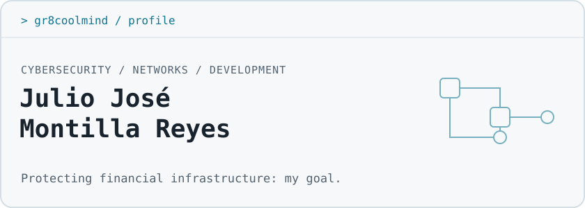

[ES](README.md) | **EN**

<picture>
  <source media="(prefers-color-scheme: dark)" srcset="assets/header-dark.en.svg">
  <source media="(prefers-color-scheme: light)" srcset="assets/header-light.en.svg">
  
</picture>

<picture>
  <source media="(prefers-color-scheme: dark)" srcset="https://readme-typing-svg.demolab.com/?font=Fira+Code&amp;size=16&amp;duration=2800&amp;pause=1500&amp;color=67E8F9&amp;width=390&amp;height=38&amp;vCenter=true&amp;lines=Cybersecurity+at+TEP-PUCMM%3BNetwork+security%3BBuilding+web+and+mobile+tools%3BFirst+role+in+IT+%2F+cybersecurity">
  
</picture>

## `$ whoami`

> **Julio José Montilla Reyes · Gr8coolmind** 
> Santiago de los Caballeros, Dominican Republic 
> Cybersecurity technical-program student · TEP-PUCMM 
> Open to my first role in IT support / cybersecurity

## Current focus

My studies focus on **cybersecurity and network security**, with the professional goal of **protecting financial infrastructure**.

Since 2020, I have been **Director and Lead Developer at Gr8coolmind Dev Studio**, providing web/mobile development and graphic design for clients. I use **Linux — CachyOS with Hyprland — daily**.

## Featured projects

| Project | Overview and stack |
| :--- | :--- |
| **[Bank network architecture](https://github.com/Gr8coolmind/grupo3-arquitectura-red-banco)** | Academic group project proposing a secure bank network. Includes an interactive topology, zone/VLAN segmentation, addressing and an educational firewall-rule simulator. **React · TypeScript · Vite · Tailwind CSS** |
| **[USB Tethering Pro](https://github.com/Gr8coolmind/USBTetheringPro)** | Android app that provides access to USB tethering settings and guides phone-to-computer setup. Tethering is enabled by the user in Android settings. **React Native · TypeScript · Kotlin** |
| **[Format converter](https://github.com/Gr8coolmind/convertidor-formatos)** | Web interface with a local server for converting images, audio, video, documents and data. **JavaScript · Node.js · Express · Sharp · FFmpeg · LibreOffice** |

## Stack and areas of practice

**Security and networking** 
Network security; VLANs, DMZs and firewall rules explored in the academic project.

  

**Development**

       

**Systems**

  

## Education and certifications

- **Técnico en Ciberseguridad — TEP-PUCMM:** in progress.
- **Google Network Security Specialization — Coursera, 2026:** 7 courses.

## Contact

