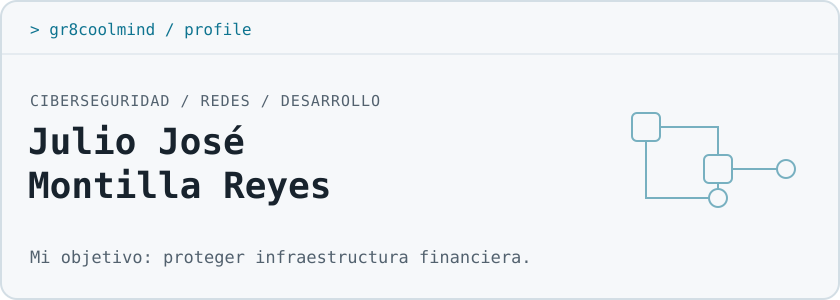

**ES** | [EN](README.en.md)

<picture>
  <source media="(prefers-color-scheme: dark)" srcset="assets/header-dark.svg">
  <source media="(prefers-color-scheme: light)" srcset="assets/header-light.svg">
  
</picture>

<picture>
  <source media="(prefers-color-scheme: dark)" srcset="https://readme-typing-svg.demolab.com/?font=Fira+Code&amp;size=16&amp;duration=2800&amp;pause=1500&amp;color=67E8F9&amp;width=390&amp;height=38&amp;vCenter=true&amp;lines=Ciberseguridad+en+TEP-PUCMM%3BSeguridad+de+redes%3BDesarrollo+web+y+m%C3%B3vil%3BPrimer+rol+en+TI+%2F+ciberseguridad">
  
</picture>

## `$ whoami`

> **Julio José Montilla Reyes · Gr8coolmind** 
> Santiago de los Caballeros, República Dominicana 
> Estudiante del Técnico en Ciberseguridad · TEP-PUCMM 
> Abierto a mi primer rol en soporte técnico TI / ciberseguridad

## Enfoque actual

Mi formación se centra en **ciberseguridad y seguridad de redes**, con el objetivo profesional de **proteger infraestructura financiera**.

Desde 2020 soy **director y desarrollador principal de Gr8coolmind Dev Studio**, donde realizo desarrollo web/móvil y diseño gráfico para clientes. Uso **Linux — CachyOS + Hyprland — a diario**.

## Proyectos destacados

| Proyecto | Descripción y stack |
| :--- | :--- |
| **[Arquitectura de red bancaria](https://github.com/Gr8coolmind/grupo3-arquitectura-red-banco)** | Proyecto académico grupal de arquitectura de red segura para un banco. Incluye topología interactiva, segmentación por zonas/VLAN, direccionamiento y simulador didáctico de reglas de firewall. **React · TypeScript · Vite · Tailwind CSS** |
| **[USB Tethering Pro](https://github.com/Gr8coolmind/USBTetheringPro)** | Aplicación Android que facilita el acceso a los ajustes de anclaje USB y guía la conexión del teléfono al ordenador. El usuario activa el anclaje desde los ajustes de Android. **React Native · TypeScript · Kotlin** |
| **[Convertidor de formatos](https://github.com/Gr8coolmind/convertidor-formatos)** | Herramienta con interfaz web y servidor local para convertir imágenes, audio, vídeo, documentos y datos. **JavaScript · Node.js · Express · Sharp · FFmpeg · LibreOffice** |

## Stack y áreas de práctica

**Seguridad y redes** 
Seguridad de redes; VLAN, DMZ y reglas de firewall trabajadas en el proyecto académico.

  

**Desarrollo**

       

**Sistemas**

  

## Formación y certificaciones

- **Técnico en Ciberseguridad — TEP-PUCMM:** en curso.
- **Google Network Security Specialization — Coursera, 2026:** 7 cursos.

## Contacto

